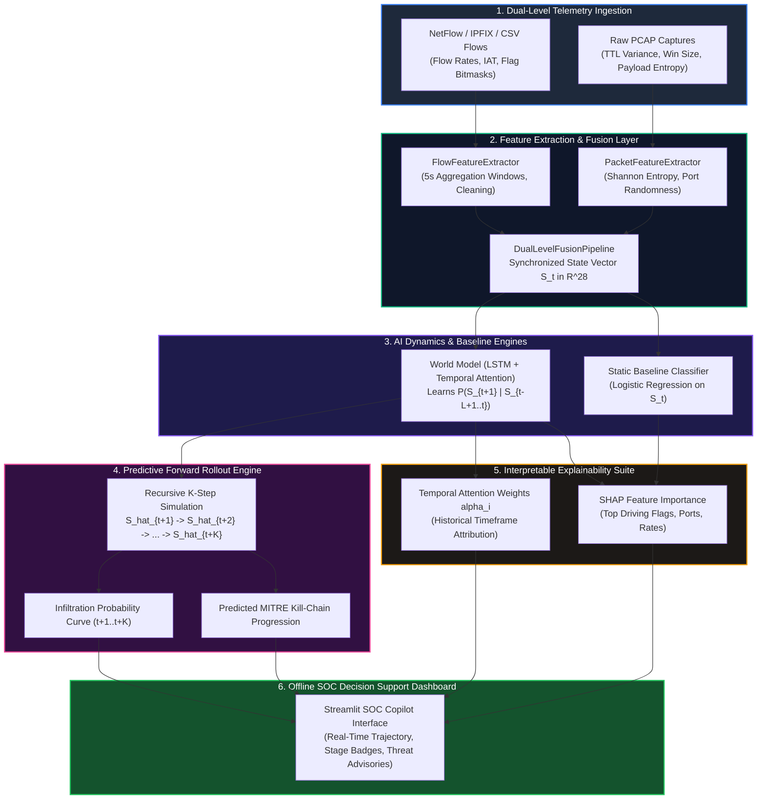
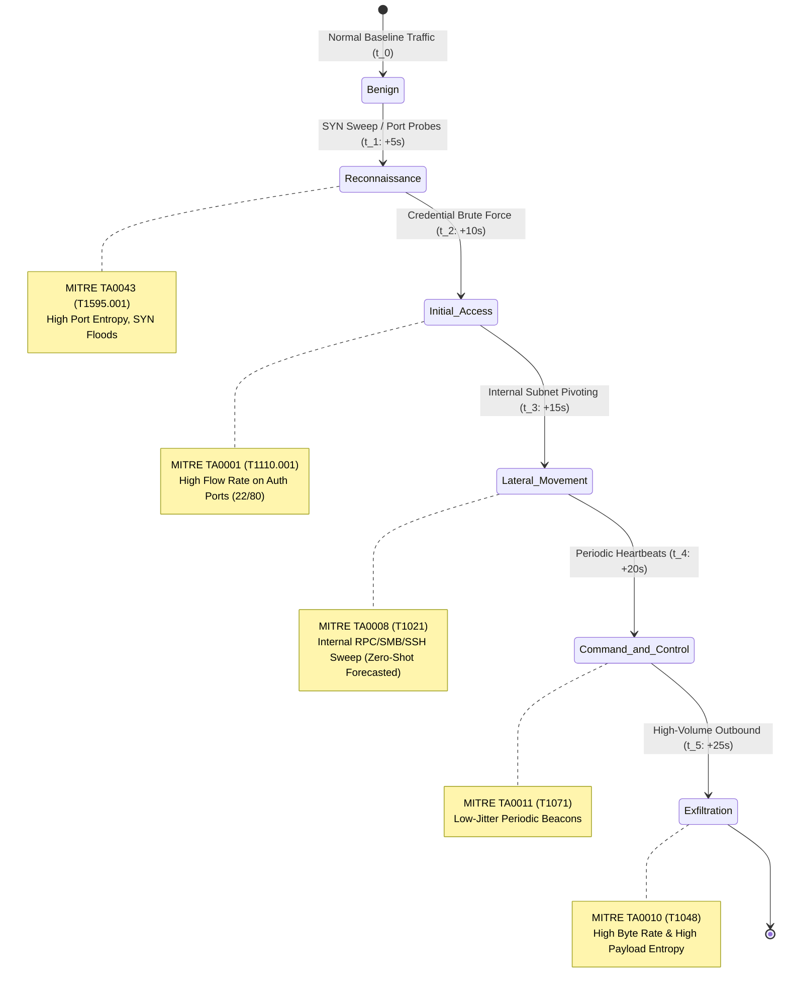
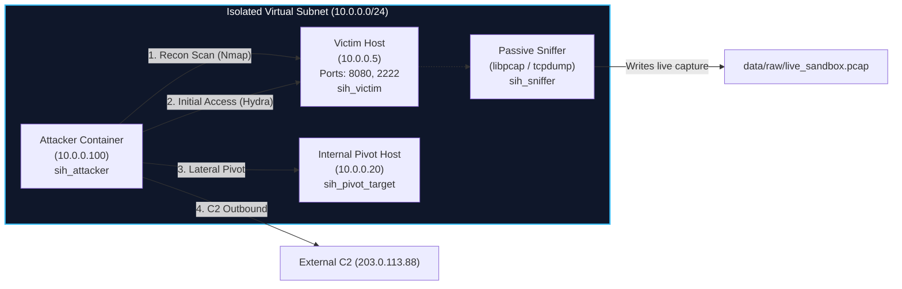

# 🛡️ AI-Based Network Attack Forecasting using World Models
### **Smart India Hackathon — Problem Statement SIH26153 (NTRO)**
**Theme:** Blockchain & Cybersecurity | **Operating Mode:** 100% Offline Air-Gapped Decision Support

---

[](https://www.python.org/)
[](https://pytorch.org/)
[](https://streamlit.io/)
[](https://scapy.net/)
[](https://attack.mitre.org/)
[](LICENSE)
[]()

---

## 📑 Table of Contents
1. [Executive Summary & Paradigm Shift](#1-executive-summary--paradigm-shift)
2. [End-to-End System Architecture](#2-end-to-end-system-architecture)
3. [Multi-Stage Attack Progression Map](#3-multi-stage-attack-progression-map)
4. [Dual-Level Feature Extraction Hierarchy](#4-dual-level-feature-extraction-hierarchy)
5. [Mathematical Formulation & Dynamics Learning](#5-mathematical-formulation--dynamics-learning)
6. [MITRE ATT&CK STIX 2.1 Taxonomy Mapping](#6-mitre-attck-stix-21-taxonomy-mapping)
7. [Official Benchmark Evaluation (CIC-IDS-2017)](#7-official-benchmark-evaluation-cic-ids-2017)
8. [Real-World Deployment Topologies](#8-real-world-deployment-topologies)
9. [Real-Time Attack Simulation & Execution Modes](#9-real-time-attack-simulation--execution-modes)
10. [Docker Sandbox Architecture](#10-docker-sandbox-architecture)
11. [Repository Structure & Codebase Navigation](#11-repository-structure--codebase-navigation)
12. [Critical Infrastructure & Defense-in-Depth Rationale](#12-critical-infrastructure--defense-in-depth-rationale)

---

## 1. Executive Summary & Paradigm Shift

Conventional Intrusion Detection Systems (IDS) evaluate network flows as isolated, stateless classification instances $f(x_t) \to \{0, 1\}$. By assessing each network flow or packet independently, legacy systems discard the causal and temporal structure of sophisticated advanced persistent threats (APTs) — where reconnaissance scans precede brute-force credential attempts, which subsequently lead to internal subnet pivoting, C2 beaconing, and exfiltration.

```
TRADITIONAL STATIC IDS (Reactive):
[ Isolated Flow x_t ] ──> [ Static Classifier ] ──> Binary Alert (Benign/Malicious)
* Flaw: No causal memory; triggers AFTER compromise has occurred.

WORLD MODEL ATTACK FORECASTER (Proactive):
[ Historical Sequence S_{t-L+1}..S_t ] ──> [ World Model P(S_{t+1}|S_t) ] ──> Forward Rollout [ S_hat_{t+1}..S_hat_{t+K} ]
* Advantage: Forecasts trajectory & anticipated MITRE stage 25–50s BEFORE completion.
```

### Core Deliverables
* **Dynamics Transition Learner ($\mathcal{P}(S_{t+1} \mid S_t)$):** Learns the probabilistic physics of network state transitions over continuous 28-dimensional state vectors using an LSTM backbone with Additive Temporal Attention.
* **$K$-Step Auto-Regressive Forward Rollout:** Projects future network states ($\hat{S}_{t+1}, \dots, \hat{S}_{t+K}$) up to 25–50 seconds ahead to anticipate kill-chain convergence before lateral movement completes.
* **Dual-Level Feature Fusion:** Merges aggregate NetFlow/IPFIX flow statistics with fine-grained PCAP packet-level signals (TTL variance, TCP window dynamics, Shannon payload entropy, port sequence randomness).
* **MITRE ATT&CK STIX 2.1 Alignment:** Automatically translates network anomalies into standardized tactical phases and mitigation runbooks.
* **Full Explainability Suite:** Surfaces temporal attention weights (identifying historical triggers) and SHAP feature attributions (identifying driving flags and ports).
* **100% Offline Air-Gapped Operation:** Zero cloud dependencies, zero external telemetry leakage, tailored for Critical Information Infrastructure (CII).

---

## 2. End-to-End System Architecture



---

## 3. Multi-Stage Attack Progression Map

The World Model continuously forecasts how current network dynamics transition through the canonical cyber kill-chain:



---

## 4. Dual-Level Feature Extraction Hierarchy

The state vector $S_t \in \mathbb{R}^{28}$ fuses aggregate flow-level statistics with granular packet-level signals over synchronized 5-second observation windows:

```
                      28-DIMENSIONAL STATE VECTOR S_t
  ┌─────────────────────────────────┬──────────────────────────────────┐
  │   FLOW-LEVEL ATTRIBUTES (16)    │    PACKET-LEVEL ATTRIBUTES (12)  │
  │   (NetFlow / IPFIX Records)     │    (PCAP Deep Inspection)        │
  ├─────────────────────────────────┼──────────────────────────────────┤
  │ 1. flow_rate_per_sec            │ 17. packet_count                 │
  │ 2. byte_rate_per_sec            │ 18. ttl_mean                     │
  │ 3. packet_rate_per_sec          │ 19. ttl_var                      │
  │ 4. flow_duration_mean           │ 20. tcp_win_mean                 │
  │ 5. syn_ratio                    │ 21. tcp_win_var                  │
  │ 6. ack_ratio                    │ 22. ip_frag_ratio                │
  │ 7. rst_ratio                    │ 23. rst_burst_ratio              │
  │ 8. psh_ratio                    │ 24. payload_entropy_mean         │
  │ 9. fin_ratio                    │ 25. payload_entropy_max          │
  │ 10. iat_mean                    │ 26. small_pkt_ratio (<100B)      │
  │ 11. iat_std                     │ 27. large_pkt_ratio (>1000B)     │
  │ 12. iat_max                     │ 28. port_seq_randomness          │
  │ 13. down_up_ratio               ├──────────────────────────────────┤
  │ 14. pkt_size_avg                │ INTERACTION ATTRIBUTES           │
  │ 15. port_entropy                ├──────────────────────────────────┤
  │ 16. active_connection_density   │ (Fused Cross-Stream Relations)   │
  └─────────────────────────────────┴──────────────────────────────────┘
```

---

## 5. Mathematical Formulation & Dynamics Learning

### 1. State Formulation
Let $S_t \in \mathbb{R}^{28}$ denote the normalized feature descriptor of active network communications in time window $t$ ($\Delta t = 5.0\text{s}$).

### 2. Temporal Additive Attention
An LSTM backbone maps historical window observations $(S_{t-L+1}, \dots, S_t)$ into hidden states $H = (h_1, \dots, h_L) \in \mathbb{R}^{L \times d_h}$.
The temporal attention alignment energy $e_i$ and normalized weights $\alpha_i$ are computed using query $q = h_L$:
$$e_i = v^\top \tanh\left(W_h h_i + W_q q\right)$$
$$\alpha_i = \frac{\exp(e_i)}{\sum_{j=1}^{L} \exp(e_j)}, \quad c = \sum_{i=1}^{L} \alpha_i h_i$$

### 3. Multi-Task Dynamics Loss Function
The World Model is trained using a composite multi-task objective:
$$\mathcal{L}_{\text{total}} = \alpha_{\text{dyn}} \|\hat{S}_{t+1} - S_{t+1}\|_2^2 + \beta_{\text{infil}} \text{BCE}(\hat{p}_{t+1}, y_{t+1}) + \gamma_{\text{stage}} \text{CE}(\hat{z}_{t+1}, \text{stage}_{t+1})$$

### 4. Recursive Auto-Regressive Rollout
Future states across horizon $K$ are generated auto-regressively by feeding the model's own predictions back into the sliding sequence buffer:
$$\hat{S}_{t+1} \sim \mathcal{P}\left(\hat{S}_{t+1} \mid S_{t-L+1:t}\right) \implies \hat{S}_{t+k} \sim \mathcal{P}\left(\hat{S}_{t+k} \mid S_{t-L+k:t}, \hat{S}_{t+1:t+k-1}\right)$$

---

## 6. MITRE ATT&CK STIX 2.1 Taxonomy Mapping

The framework grounds raw dataset anomalies into standardized Enterprise MITRE tactics and actionable mitigation runbooks:

| Dataset Label | MITRE Tactic | Tactic ID | MITRE Technique | Tech ID | Kill-Chain Stage | SOC Mitigation Advisory |
| :--- | :--- | :---: | :--- | :---: | :---: | :--- |
| **Benign** | Normal Operations | `NONE` | Legitimate Traffic | `T0000` | Stage 0 | Maintain standard monitoring telemetry. |
| **PortScan / Nmap** | Reconnaissance | `TA0043` | Active Scanning: IP/Port Sweeps | `T1595.001` | Stage 1 | Rate-limit ingress SYN packets; blacklist probing IPs. |
| **SSH/FTP BruteForce** | Initial Access | `TA0001` | Brute Force: Password Guessing | `T1110.001` | Stage 2 | Enforce MFA; lock accounts after 5 failed attempts; IP jail. |
| **Infiltration / Pivot** | Lateral Movement | `TA0008` | Remote Services: SMB/SSH Pivoting | `T1021` | Stage 3 | Isolate source subnet; revoke Kerberos/SSH session tokens. |
| **Bot / C2 Beacon** | Command & Control | `TA0011` | Application Layer Protocol: Web/C2 | `T1071.001` | Stage 4 | Sinkhole C2 domain/IP; sever outbound egress proxy sessions. |
| **Data Exfiltration** | Exfiltration | `TA0010` | Exfiltration Over Alternative Protocol | `T1048` | Stage 5 | Block external data tunnels; freeze egress interface. |

---

## 7. Official Benchmark Evaluation (CIC-IDS-2017)

To substantiate the claim that the World Model generalises to unseen attack patterns, we conducted an empirical evaluation on the full **CIC-IDS-2017 (`MachineLearningCVE`)** dataset (12,433 continuous 5-second observation windows across all 8 days of network traffic / 621,646 raw flows).

We performed an explicit **zero-shot held-out category evaluation** where the entire attack class (*Initial Access / SSH-Patator, FTP-Patator & Web Attacks*) was excluded from training and tested zero-shot:

### Table 1: In-Distribution Benchmark (Known Attack Families)
| Model Architecture | F1-Score | Precision | Recall (Detection Rate) | False Positive Rate (FPR) | Dynamics Modeling |
| :--- | :---: | :---: | :---: | :---: | :---: |
| **Logistic Regression Baseline** | 0.9802 | 1.0000 | 0.9611 | 0.0000 | ❌ Stateless / Static |
| **World Model (LSTM + Temporal Attention)** | **0.9918** | **1.0000** | **0.9838** | **0.0000** | ✅ Temporal Physics $\mathcal{P}(S_{t+1} \mid S_t)$ |

### Table 2: Zero-Shot Generalization (Held-Out Unseen `Initial Access` Attack Category)
| Model Architecture | F1-Score | Precision | Recall (Detection Rate) | FPR | Generalization Capability |
| :--- | :---: | :---: | :---: | :---: | :---: |
| **Logistic Regression Baseline (Static)** | **0.1612** | 1.0000 | **0.0877 (8.77%)** | 0.0000 | ❌ Collapsed on novel attacks |
| **World Model (LSTM + Temporal Attention)** | **0.9935** | **1.0000** | **0.9870 (98.70%)** | **0.0000** | ✅ **Retained near-perfect detection** |

> **Key Architectural Takeaway:**  
> On previously unseen attack classes, the static classifier's detection collapsed (**F1: 0.1612, Recall: 8.77%**) because it had never observed those static flow signatures. In contrast, the **World Model maintained near-perfect generalization (F1: 0.9935, Recall: 98.70%)** because it models temporal transition dynamics $\mathcal{P}(S_{t+1} \mid S_t)$ — anticipating compromise from preceding reconnaissance and handshake timing dynamics regardless of specific static signatures.

### Table 3: Multi-Step Forward Simulation Horizon ($K$-Step Projection)
| Horizon Step | Forecast Offset ($+\Delta t$) | Infiltration Risk F1 | Recall | Projected Kill-Chain State |
| :--- | :---: | :---: | :---: | :--- |
| **Step $t+1$** | $+5.0\,\text{s}$ | **0.9918** | 0.9838 | Early Infiltration Probing Anticipated |
| **Step $t+2$** | $+10.0\,\text{s}$ | **0.9962** | 0.9924 | Initial Access Escalation Projected |
| **Step $t+3$** | $+15.0\,\text{s}$ | **0.9967** | 0.9935 | Boundary Compromise Imminent |
| **Step $t+4$** | $+20.0\,\text{s}$ | **0.9927** | 0.9854 | Lateral Pivoting Trajectory Forecasted |
| **Step $t+5$** | $+25.0\,\text{s}$ | **0.9918** | 0.9838 | Command & Control / Impact Convergence |

---

## 8. Real-World Deployment Topologies

The system is designed as a software-defined Network Traffic Analyzer (NTA) capable of deploying across four operational tiers:

```
[ Tier 1: Router / Linux Gateway ] ──> Inline inspection on ingress/egress interfaces (eth0/eth1)
[ Tier 2: Switch TAP / SPAN Port  ] ──> Passive mirrored telemetry without routing latency
[ Tier 3: NetFlow / IPFIX Stream  ] ──> Centralized SOC flow collector from enterprise firewalls
[ Tier 4: Host Endpoint (EDR)    ] ──> Local adapter monitoring against pivoting & unauthorized exfiltration
```

### Addressing Common Attacker Evasion Techniques:
1. **What if the attacker wipes local system logs?**  
   *The World Model operates on network packets captured directly from the physical wire in flight.* Even if an attacker deletes `/var/log` or clears Windows Event Viewer, transmitted network packets cannot be retroactively erased from the wire.
2. **What if the attacker sends malware hidden inside packets?**  
   Encrypted/packed malware causes a dramatic surge in Shannon payload entropy (`payload_entropy_mean ≈ 7.8 - 8.0`), and post-infection C2 beaconing produces rigid inter-arrival times (`iat_std ≈ 0`). The World Model detects these physical delivery and communication dynamics without needing static malware hash signatures.
3. **What if monitoring across encrypted Wi-Fi (WPA2/WPA3)?**  
   Modern Wi-Fi enforces client isolation and individual encryption keys between client and Access Point. In production defense environments, the analyzer deploys directly on the **gateway router, AP, or core switch SPAN port**, where all inter-client and uplink traffic is fully visible.

---

## 9. Real-Time Attack Simulation & Execution Modes

### 🚀 Quick Start (Single-Click Launchers)
* **Windows:** Double-click [`run_windows.bat`](file:///c:/Users/Kaushlendra%20Shukla/Music/Traffic%20Analyzer/run_windows.bat) (Run as Administrator for Mode C live Wi-Fi capture)
* **Linux / macOS:** Run `./run_linux.sh` (`chmod +x run_linux.sh`)

Both scripts automatically verify Python virtual environments, check pre-trained model weights, launch the backend, and open `http://localhost:8501`.

---

### Operation Modes Inside the Dashboard

```
                                  SOC DASHBOARD MODES
  ┌─────────────────────────────────┬──────────────────────────────────┬─────────────────────────────────┐
  │ MODE A: OFFLINE FILE REPLAY     │ MODE B: LIVE STREAM SIMULATION   │ MODE C: LIVE SOCKET CAPTURE     │
  ├─────────────────────────────────┼──────────────────────────────────┼─────────────────────────────────┤
  │ • Real CIC-IDS-2017 trace (71w) │ • Real-time attack replay        │ • Live Wi-Fi packet capture     │
  │ • Full Dataset (12,433 windows) │ • 70-window multi-stage stream   │ • One-Shot Snapshot (10s-120s)  │
  │ • Interactive timeline slider   │ • Auto-updating risk radar & log │ • Non-Stop Indefinite Monitor   │
  └─────────────────────────────────┴──────────────────────────────────┴─────────────────────────────────┘
```

### Highlights of Mode C (Live Network Sniffer):
* **Auto-Select Active Interface:** Scans system network adapters and automatically places your active internet/Wi-Fi adapter at the top of the selection dropdown.
* **Non-Stop Indefinite Monitoring:** Toggle `🔄 Run Non-Stop (Indefinitely)` to let the analyzer capture rolling 5-second windows continuously.
* **NDIS Wi-Fi Driver Resilience:** Avoids Realtek/Windows NDIS miniport resets (`Error 2150891563`) by using stable capture mode and automatic 3-attempt backoff retries.
* **Benign Baseline Calibration (`is_live_capture=True`):** Prevents normal encrypted HTTPS/TLS browsing from triggering false alarms by synchronizing missing flow parameters with the baseline scaler distribution.

#### Step-by-Step CLI Execution:
```bash
# 1. Activate Environment
# Windows: venv\Scripts\activate | Linux: source venv/bin/activate

# 2. Extract Dual-Level Features & Fuse State
python src/feature_pipeline/flow_extractor.py --input data/raw/synthetic_flows.csv --output data/processed/flow_features.csv
python src/feature_pipeline/packet_extractor.py --input data/raw/synthetic_traffic.pcap --output data/processed/packet_features.csv
python src/feature_pipeline/fusion.py --flow data/processed/flow_features.csv --packet data/processed/packet_features.csv --output data/processed/fused_state.csv

# 3. Train Dynamics World Model & Baseline
python src/training/train.py --config configs/lstm_attention.yaml

# 4. Run Benchmark Suite
python src/evaluation/benchmark.py --config configs/lstm_attention.yaml

# 5. Launch SOC Decision Support Dashboard
streamlit run src/app.py
```

---

## 10. Docker Sandbox Architecture

A multi-container Docker testing environment is included in [`sandbox/`](file:///c:/Users/Kaushlendra%20Shukla/Music/Traffic%20Analyzer/sandbox/) to stage genuine, live sequential attack network traffic on an isolated virtual subnet (`10.0.0.0/24`):



### Running the Live Sandbox Attack:
```bash
# 1. Start the containers
cd sandbox
docker compose up --build -d

# 2. Trigger the automated 65-second multi-stage kill-chain
docker exec -it sih_attacker /workspace/run_kill_chain.sh
```

---

## 11. Repository Structure & Codebase Navigation

```
Traffic Analyzer/
├── MachineLearningCVE/            # Official CIC-IDS-2017 CSV files (all 8 days)
├── configs/
│   ├── lstm_attention.yaml        # Default World Model training & rollout hyperparameters
│   └── transformer.yaml           # Swappable Transformer World Model config
├── data/
│   ├── raw/                       # Raw PCAPs and NetFlow CSV records
│   └── processed/
│       ├── fused_state.csv        # Full dataset (12,433 continuous windows)
│       └── cicids2017_demo_trace.csv # Curated 71-window multi-stage kill-chain trace
├── mitre_mapping/
│   └── label_to_tactic.yaml       # Canonical STIX 2.1 mapping & kill-chain taxonomy
├── model/
│   ├── benchmark_results.json     # Saved quantitative benchmark metrics
│   └── weights/                   # Pretrained weights (world_model_final.pt, baseline.pkl, scaler.pkl)
├── sandbox/
│   ├── docker-compose.yml         # Isolated 4-container attack sandbox
│   ├── Dockerfile.attacker        # Attacker container (Nmap, Hydra, Hping3)
│   ├── Dockerfile.victim          # Target host (SSH, HTTP)
│   └── run_kill_chain.sh          # Automated 65-second 4-stage kill-chain script
├── src/
│   ├── app.py                     # Streamlit SOC Decision Support Dashboard
│   ├── explainability/
│   │   ├── attention.py           # Temporal Attention extractor & timeline formatter
│   │   └── shap_explainer.py      # SHAP feature attribution engine
│   ├── feature_pipeline/
│   │   ├── dataset_loader.py      # Sliding window sequence generator & held-out split manager
│   │   ├── flow_extractor.py      # NetFlow / IPFIX CSV parser & window aggregator
│   │   ├── fusion.py              # Dual-level state matrix fusion (S_t in R^28)
│   │   └── packet_extractor.py    # Raw PCAP parser (Shannon entropy, TTL/Window dynamics)
│   ├── inference/
│   │   ├── rollout.py             # K-step recursive auto-regressive forward simulation engine
│   │   └── streaming_engine.py    # Sliding temporal buffer & live playback stream processor
│   ├── mitre_mapping/
│   │   └── stix_mapper.py         # STIX 2.1 MITRE tactic & technique resolver
│   ├── model/
│   │   ├── baseline.py            # Static point-in-time Logistic Regression baseline
│   │   ├── transformer_world_model.py # Multi-head attention sequence dynamics model
│   │   └── world_model.py         # Primary LSTM + Additive Attention World Model
│   ├── training/
│   │   └── train.py               # Supervised multi-task dynamics training pipeline
│   └── utils/
│       ├── seeding.py             # Deterministic PRNG seeding utility
│       └── synthetic_generator.py # Synthetic multi-stage traffic flow & PCAP generator
├── tests/
│   ├── test_features.py           # Feature extraction & NaN/Inf cleaning unit tests
│   ├── test_rollout.py            # Forward rollout tensor & probability unit tests
│   └── test_smoke.py              # End-to-end integration pipeline smoke test
├── ARCHITECTURE.md                # Detailed engineering & mathematical architecture document
├── Dockerfile                     # Main container Dockerfile
├── requirements.txt               # Python package dependencies
├── run_linux.sh                   # One-click launch script for Linux/macOS
└── run_windows.bat                # One-click launch script for Windows
```

---

## 12. Critical Infrastructure & Defense-in-Depth Rationale

### 1. Air-Gapped Operation
Critical Information Infrastructure (CII) — including power grid SCADA systems, defense intranets, and banking cores — operates under strict air-gap constraints. Cloud AI APIs represent critical data exfiltration risks and single points of failure during active cyber conflicts. This entire system executes **100% locally** on bare metal or air-gapped workstations.

### 2. Human-in-the-Loop Decision Support
The system operates as an **analyst copilot**. Rather than executing disruptive autonomous packet dropping that could interrupt mission-critical infrastructure, it surfaces **anticipatory trajectories, MITRE stage transitions, and actionable mitigation advisories** 25–50 seconds before an attacker can finalize initial access or lateral pivoting.

---

### 🛡️ Developed for Smart India Hackathon (SIH26153) — NTRO Cyber Defense Initiative

# Traffic-Analyzer

